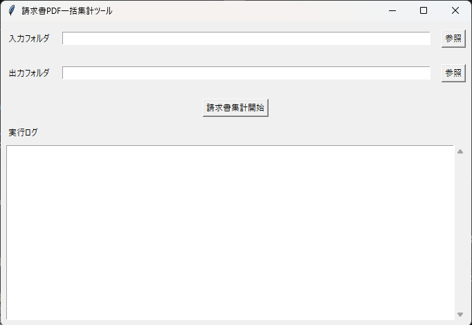
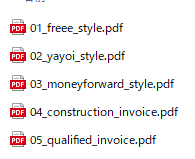
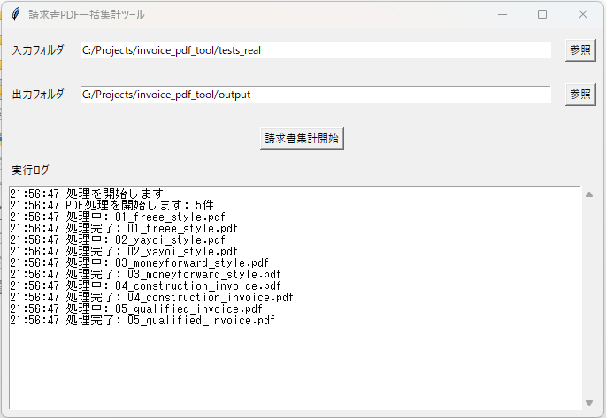
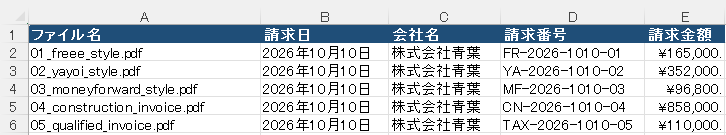

# 請求書PDF一括集計ツール

## 概要

請求書PDFをフォルダ単位で読み込み、請求日・会社名・請求番号・請求金額を抽出してExcelファイルにまとめる、Windows向けのデスクトップツールです。

PDFに文字情報が含まれていることを前提としており、PDF内の決められた項目名を使って情報を取得します。読み取れなかったファイルや項目は、アプリ画面の実行ログとExcelのErrorシートで確認できます。`logs/app.log` には実行日時、処理件数、エラー件数が記録されます。

## 主な機能

- GUIで入力フォルダと出力フォルダを選択
- 選択した入力フォルダにあるPDFファイルをまとめて処理
- 請求日、会社名、請求番号、請求金額を抽出
- `請求書一覧.xlsx` を出力
- Excelに一覧、エラー、集計の各シートを作成
- 処理状況を画面に表示し、実行結果の概要を `logs/app.log` に記録
- PDFから取得したテキストの文字数と先頭300文字を、ソースコード版ではコンソールに表示

## 画面と出力の例

操作の流れが分かりやすいよう、画像は「起動直後 → 入力PDF → 処理完了 → Excel出力」の順に掲載します。

### 1. 起動直後の画面

入力フォルダと出力フォルダを指定して処理を始めます。



### 2. 入力するPDF

入力フォルダに、処理対象のPDFファイルを配置します。



### 3. 処理中・処理完了後の画面

実行ログにPDFごとの処理開始・完了状況が表示されます。



### 4. Excel出力結果

抽出されたファイル名、請求日、会社名、請求番号、請求金額を一覧で確認できます。



## 動作環境

- Windows
- exe版: Windows上で実行できる環境
- ソースコード版: Python 3.10以上、Tkinterが利用できる環境

## インストール方法

### exe版

配布物に `InvoicePdfTool.exe` が含まれている場合は、書き込み可能なフォルダに配置してください。設定を変更する場合は、同じ場所に `config.json` を配置します。EXEが配布されていない場合は、ソースコード版をご利用ください。

### ソースコード版

プロジェクトをダウンロードまたはクローンし、プロジェクトフォルダでPowerShellを開いて次を実行してください。

```powershell
py -3 -m venv .venv
.\.venv\Scripts\Activate.ps1
python -m pip install -r requirements.txt
```

## 使用方法

### exe版

1. `InvoicePdfTool.exe` を起動します。
2. 初期設定では、exeと同じフォルダにある `invoices` フォルダが入力先、`output` フォルダが出力先です。画面の「参照」から変更できます。
3. 入力フォルダに処理したいPDFを入れます。
4. 「請求書集計開始」を押します。
5. 出力先の `請求書一覧.xlsx` を確認します。実行概要はexeと同じ場所の `logs/app.log` に追記されます。ファイルごとの処理状況やエラー内容はアプリ画面の実行ログで確認できます。

exeと同じ場所に `config.json` がある場合、その設定を使用します。ない場合はexeに同梱された初期設定を使用します。初期設定は入力先が `invoices`、出力先が `output` です。

EXEはコンソールを表示しない設定で作成されています。PDFテキストの文字数や先頭300文字をコンソールで確認する場合は、ソースコード版を端末から起動してください。

### ソースコード版

1. インストール手順に従って依存パッケージをインストールします。
2. プロジェクトフォルダで次を実行します。

```powershell
python app.py
```

3. GUIで入力フォルダと出力フォルダを確認または選択します。
4. 入力フォルダにPDFを入れ、「請求書集計開始」を押します。
5. 出力先の `請求書一覧.xlsx` を確認します。

## 出力項目

出力ファイル名は `請求書一覧.xlsx` です。次の3つのシートを作成します。

| シート | 主な項目 |
| --- | --- |
| Invoice | ファイル名、請求日、会社名、請求番号、請求金額 |
| Error | ファイル名、エラー内容 |
| Summary | 正常に処理できた請求書の件数、合計請求額、平均請求額 |

請求金額はExcel上で数値として保存され、円表示の書式が設定されます。

## フォルダ構成

```text
invoice_pdf_tool/
├── app.py                  # アプリ本体
├── config.json             # 入力・出力フォルダの初期設定
├── requirements.txt        # Python依存パッケージ
├── InvoicePdfTool.spec     # PyInstaller設定
├── README.md
├── invoices/               # 初期設定の入力フォルダ
├── output/                 # 初期設定の出力フォルダ
├── logs/                   # 実行概要ログ
├── tests/                  # テスト用フォルダ
├── GUI_TEST/               # GUI確認用PDF
├── tests_real/             # PDF抽出確認用サンプル
├── dist/                   # exe版の出力先
└── build/                  # exeビルド時の作業ファイル
```

`output`、`logs`、`dist`、`build` は実行やビルドに応じて作成されます。配布パッケージによっては、一部のフォルダが含まれない場合があります。

## 動作確認済み形式

PDF内にテキスト情報があり、次の項目がそれぞれ1行で記載された形式を対象としています。項目名とコロンはこの表記に合わせてください。

```text
請求日: 2026年10月10日
会社名: 株式会社青葉
請求番号: INV-2026-001
請求金額: ¥110,000
```

次のサンプルPDFで、テキスト取得と4項目の抽出を確認しています。

- `invoices` 内の請求書サンプル3件
- `tests_real` 内の独自作成サンプル5件（freee風、弥生風、マネーフォワード風、建設業向け、インボイス制度対応）

「各サービス風」のサンプルはレイアウト例として作成したもので、各サービスの公式帳票ではありません。これらと異なる帳票での動作を保証するものではありません。

## 既知の制限事項

- スキャン画像だけのPDFや手書き文字は読み取れません。OCR機能はありません。
- 項目名が「請求日」「会社名」「請求番号」「請求金額」と異なる場合や、値が項目名と同じ行にない場合は抽出できないことがあります。
- PDFの文字配置や文字エンコードによって、テキストを取得できない場合があります。
- 請求金額は、抽出した文字列から数字・小数点・マイナス記号を取り出してExcelの数値に変換します。複雑な金額表記は意図した値にならない場合があります。
- 1つの入力フォルダ内にあるPDFを処理します。PDF以外のファイルやサブフォルダ内のPDFは対象外です。
- 税率別集計、インボイス登録番号の検証、会計サービスとの連携は行いません。
- 入力フォルダにPDFがない場合は処理を終了し、Excelファイルは出力しません。

## 更新履歴

- 初版: PDFの一括読み込み、項目抽出、Excel出力、GUI、実行ログに関する利用方法を記載
